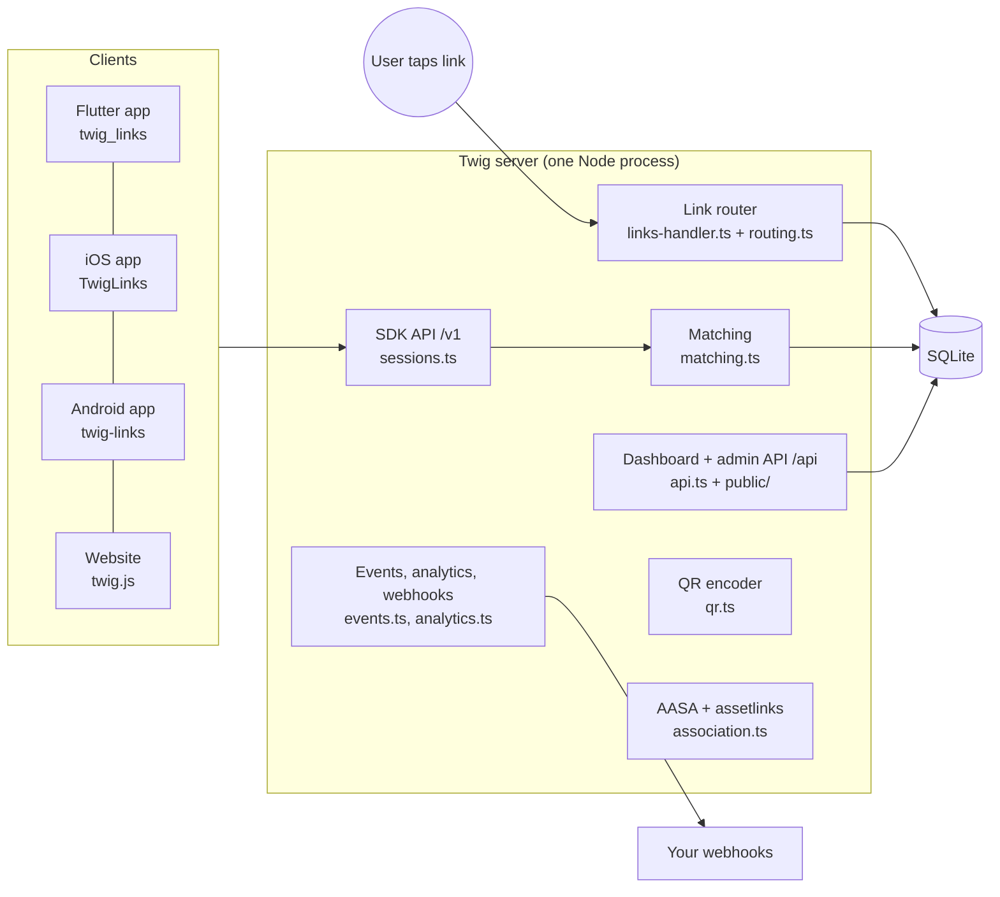

# Twig architecture

## Components



| File | Responsibility |
|------|----------------|
| `server/src/routing.ts` | **Selection logic** — pure `decideRoute()` → redirect / interstitial / preview page |
| `server/src/links-handler.ts` | Click pipeline: UA parsing, link resolution, click recording, cookies, page rendering |
| `server/src/matching.ts` | Deferred deep linking: click id, URLs, install referrer, pasteboard, fingerprint scoring |
| `server/src/sessions.ts` | `/v1/open`, `/v1/web/open`, `/v1/event`, `/v1/identity` |
| `server/src/links.ts` | Short links, aliases, long links, path links, dedupe |
| `server/src/apps.ts` | Apps, config validation, keys, domains |
| `server/src/association.ts` | `apple-app-site-association` and `assetlinks.json` |
| `server/src/pages.ts` | Interstitial, preview, desktop and fallback pages (strict CSP with nonces) |
| `server/src/qr.ts` | QR encoder (versions 1–40, SVG and PNG), no dependencies |
| `server/src/events.ts` | Event log and signed, retried webhooks |
| `server/src/analytics.ts` | Summaries, time series, breakdowns, per-link funnels |
| `server/src/auth.ts` | Team accounts (scrypt), sessions, CSRF guard, setup token |

## Data model (SQLite)

| Table | Key columns |
|-------|-------------|
| `apps` | `public_key` (SDK), `secret_hash` (server API), `config` (JSON: iOS, Android, URLs, OG, banner, match window) |
| `domains` | `host` → `app_id`, `kind` = primary / alternate |
| `links` | `code` (short code or alias), `data` (JSON), channel / feature / campaign / stage / tags, `dedupe_hash` |
| `clicks` | click id, link snapshot, HMAC'd IP + IP prefix, OS, version, model, language, browser cookie id, route taken, claimed flag |
| `devices` | device token, hardware id, platform, identity, install link, last touch (for event attribution) |
| `events` | click / install / reinstall / open / web_open / event / link_created with tags and revenue |
| `webhooks`, `webhook_deliveries` | endpoint, events, secret; delivery queue with retries |
| `users`, `user_sessions` | team accounts and hashed session tokens |

Privacy: IP addresses are never stored — only `HMAC(server_secret, ip)` and of its /24 or /64
prefix, enough for equality matching. Click fingerprints are purged after `CLICK_RETENTION_DAYS`.

## Link data conventions

| Prefix | Meaning | Examples |
|--------|---------|----------|
| `$` | control keys (routing, previews) | `$deeplink_path`, `$ios_deeplink_path`, `$android_deeplink_path`, `$ios_url`, `$ipad_url`, `$android_url`, `$desktop_url`, `$fallback_url`, `$web_only`, `$og_title`, `$og_description`, `$og_image_url`, `$match_duration`, `$uri_redirect_mode`, `$ios_deepview` |
| `~` | analytics tags (added by the server) | `~channel`, `~feature`, `~campaign`, `~stage`, `~tags`, `~id`, `~referring_link` |
| `+` | system flags (returned to apps) | `+clicked_link`, `+is_first_session`, `+match_guaranteed`, `+match_type`, `+click_timestamp`, `+non_twig_link` |
| other | your data | `product_id`, `coupon`, … |

Link forms on a link domain:

* short: `https://links.example.com/AbC123xyz` or alias `https://links.example.com/summer-sale`
* long (no API call): `https://links.example.com/?$deeplink_path=product/42&product_id=42&~channel=sms`
* path link: `https://links.example.com/products/42` (unknown multi-segment path → `$deeplink_path=products/42`)
* query overrides on short links: `?$web_only=true`, `?$desktop_url=…`

## Wire protocol (SDK → server)

All requests are `POST` JSON to the server's `/v1/*`, with the public key in `key`.

### `POST /v1/open`

```json
{
  "key": "tw_live_…",
  "is_first_launch": true,
  "device_token": "dv_…",
  "hardware_id": "…", "os": "iOS", "os_version": "18.5", "model": "iPhone15,2", "brand": "Apple",
  "app_version": "1.4.0", "locale": "en-US", "screen_width": 1179, "screen_height": 2556, "sdk": "flutter/0.1.0",
  "link_url": "https://links.example.com/AbC123xyz",
  "install_referrer": "link_click_id=1730000000000123456&utm_source=whatsapp",
  "pasteboard_url": "https://links.example.com/AbC123xyz?link_click_id=…&_cpts=…",
  "identity": "user-42"
}
```

Response: `{ "session_id", "device_token", "identity", "data": { …link data, "+clicked_link": true, … } }`.

### Others

| Endpoint | Body | Response |
|----------|------|----------|
| `POST /v1/url` | `data`, `alias`, `channel`, `feature`, `campaign`, `stage`, `tags` | `{ url, code }` (identical SDK links are reused) |
| `POST /v1/event` | `device_token`, `name`, `revenue`, `currency`, `data`, `content_items` | `{ ok, event_id, attributed }` |
| `POST /v1/identity` | `device_token`, `identity` (null = logout) | `{ ok, identity }` |
| `POST /v1/web/open` | `match_id`, `browser_token`, `url`, `referrer` | same as `/v1/open` |
| `GET /v1/config?key=` | – | banner settings, store ids, link domain |
| `GET /v1/qr?url=&format=svg\|png&scale=&ecc=` | – | QR image (URLs on registered domains only) |

## Matching order

1. `link_click_id` in the opening URL or request → **click_id** (guaranteed)
2. `link_url` on one of the app's domains → **universal_link** (guaranteed; URI schemes → click_id)
3. first launch + Play install referrer with `link_click_id` → **install_referrer** (guaranteed)
4. first launch + pasteboard URL with click id ≤ 24 h old → **pasteboard** (guaranteed)
5. no URL → **fingerprint**: same platform, same IP (50) or IP prefix (30), OS version ±, model +10, language +5, recency +0–10, threshold 45, inside the click's match window; for regular opens only clicks made after the device was last seen. Never guaranteed.

Each click can be claimed once.

## Security

* Dashboard: scrypt passwords, HTTP-only `SameSite=Lax` session cookies, `X-Twig-Client` header on every state-changing request (CSRF), login rate limit, owner / admin / member roles.
* Server API: `Authorization: Bearer tw_secret_…` scoped to one app; only the SHA-256 of secrets is stored; rotation from the dashboard.
* Public SDK API: CORS `*`, per-IP token-bucket rate limit, payload size limits.
* Pages: escaped output, strict CSP with per-response nonces, `frame-ancestors 'none'`.
* Webhooks: `X-Twig-Signature: t=…,v1=HMAC-SHA256(secret, "t.body")`.
* Caddy issues certificates only for domains Twig confirms through `/caddy/ask`.
